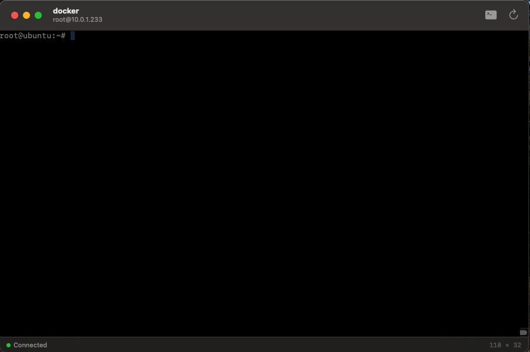

<p align="center">
  
</p>

<h1 align="center">macSSH</h1>

<p align="center">
  <strong>Gestionnaire natif macOS pour SSH / FTP / SMB, montage Finder lecture-écriture, terminal et proxy SOCKS5 dynamique</strong>
</p>

<p align="center">
  <em>Pur Swift & SwiftUI • Binaire Universel (Apple Silicon & Intel)</em>
</p>

<p align="center">
  
  
  
  <a href="../LICENSE"></a>
</p>

---

<p align="center">
  🌐 <strong>Languages / 多语言 / Ngôn ngữ / Языки / Langues</strong>
</p>

<p align="center">
  <a href="../README.md">English</a> •
  <a href="README_VI.md">Tiếng Việt</a> •
  <a href="README_ZH_CN.md">简体中文</a> •
  <a href="README_ZH_TW.md">繁體中文</a> •
  <a href="README_RU.md">Русский</a> •
  <strong>Français</strong>
</p>

---

## ⚠️ Important : Conçu exclusivement pour macOS (macOS Only)

> [!IMPORTANT]
> **macSSH est conçu spécifiquement pour Apple macOS.**
> Il s'agit d'une application 100% native développée avec **SwiftUI**, **AppKit**, **SwiftData**, **Network.framework**, **AVKit**, **PDFKit**, **NetFS** et **LocalAuthentication (Touch ID)**.
>
> L'application **NE prend PAS en charge** Windows ni Linux — garantissant une réactivité native instantanée, une latence nulle et une empreinte mémoire minimale.

---

## 🌟 Présentation du projet

**macSSH** fournit une solution complète et native pour les développeurs, ingénieurs DevOps et administrateurs système sur Mac :

- **Multi-protocoles (`SSH`, `FTP`, `SMB`)** : Gérez vos serveurs **SSH/SFTP**, **FTP/FTPS** et **SMB/CIFS** avec ports par défaut, icônes/couleurs dédiées, connexion anonyme/invité et découverte automatique des partages SMB.
- **Montage Finder lecture-écriture (FTP & SFTP)** : Montez vos serveurs FTP/FTPS et SFTP directement dans le **Finder macOS** comme des volumes natifs via un pont local WebDAV Class 2 (`SwiftNIO`) — **sans macFUSE, ni FUSE-T, ni `sudo`**.
- **Navigateur double panneau & FTP multi-flux** : Glisser-déposer bidirectionnel (Local ⇄ Distant ⇄ Finder), transferts récursifs de dossiers et **transferts FTP multi-flux configurables (10 par défaut, jusqu'à 32)** avec téléchargement parallèle par plages d'octets.
- **Visionneuse universelle intégrée** : Prévisualisez texte/code, images, PDF, audio/vidéo (`AVKit`) et hexadécimal/ASCII binaire directement dans macSSH pour SSH, FTP et SMB.
- **Réglages rapides (`Connexion auto` & `Montage auto` FTP)** : Boutons instantanés en bas à droite de chaque ligne sans rechargement de page, automatisation au démarrage / à l'ouverture de config et montage automatique FTP lors du clic sur **Connect**.
- **Terminal OpenSSH natif & Proxy SOCKS5** : Émulateur `xterm-256color` 60 FPS, lancement 1-clic dans `Terminal.app`, tunnels `/usr/bin/ssh -D` (`127.0.0.1` ou LAN `0.0.0.0`) avec nettoyage garanti des processus enfants.
- **Surveillance réseau en temps réel & Barre de menus** : Détection `NWPathMonitor`, reconnexion progressive et masquage automatique du Dock lorsque toutes les fenêtres sont fermées.

---

## ✨ Fonctionnalités clés

### 🔌 1. Gestionnaire multi-protocoles (`SSH` / `FTP` / `SMB`)
- **Sélecteur `SSH | FTP | SMB`** : Applique automatiquement les ports par défaut (`22` / `21` / `445`), l'icône et la couleur du protocole.
- **Moteur FTP / FTPS** : Basé sur `/usr/bin/curl` avec identifiants transmis en toute sécurité par `stdin`, prise en charge des listings Unix & Windows/IIS et de l'accès `anonymous`.
- **Moteur SMB / CIFS** : Basé sur `NetFS.framework` et `smbutil` avec découverte des partages réseau et démontage automatique à la déconnexion.

### 💽 2. Montage Finder lecture-écriture sans pilote (Loopback WebDAV)
- **Accès complet dans le Finder** : Pont local **SwiftNIO WebDAV Class 2** et `/sbin/mount_webdav -S -o browse`, sans kext tiers ni privilèges root.
- **Nom du serveur affiché sans `.local`** : Résolution loopback locale sur `lo0` via `dnssd` pour afficher directement le **nom** du serveur dans la barre latérale du Finder au lieu de `127.0.0.1` ou `Nom.local`.
- **Navigation fluide sans téléchargements inutiles** : Cache des répertoires (`15s`), sentinelles bloquant l'exploration QuickLook/Spotlight/FSEvents (`.ql_disablethumbnails`, `.metadata_never_index`, `.fseventsd/no_log`) et gestion locale des fichiers système macOS (`._*`, `.DS_Store`, `.TemporaryItems`) ; streaming à la demande par plages d'octets (`Range`) avec annulation immédiate si la connexion ferme.
- **Démontage automatique en 3 niveaux** : À la déconnexion, sur éjection depuis le Finder (`⏏`), en quittant (`⌘Q`), en cas de crash (`-S` + `atexit`), et nettoyage des montages orphelins au lancement.

### ⚡ 3. Réglages rapides (`Connexion auto` & `Montage auto` FTP)
- **Boutons en bas à droite de chaque élément** :
  - **`Connexion auto`** (tous protocoles) : Connecte automatiquement la session au lancement ou à l'ouverture d'une configuration.
  - **`Montage auto`** (**FTP uniquement**) : Monte silencieusement le disque dans le Finder au démarrage **et** monte automatiquement dès que vous cliquez sur **Connecter**.
- **Mise à jour instantanée sans rechargement** : Aucun scintillement ni réinitialisation de la liste lors du basculement ; prise en compte du déverrouillage Touch ID au démarrage.

### 🌐 4. Proxy SOCKS5 OpenSSH natif & cycle de vie des processus
- **Tunnel headless `/usr/bin/ssh -D`** : Via `forkpty` (compatible veille/réveil macOS), partage `127.0.0.1` ou réseau local `0.0.0.0`, détection de conflits de ports et gestion centralisée `NativeProcessRegistry` (`atexit` + gestionnaires de signaux).

### 📂 5. Navigateur double panneau, FTP multi-flux & Visionneuse universelle
- **Glisser-déposer bidirectionnel & FTP multi-flux (`1–32`, défaut `10`)** : Réglable dans les Réglages, par connexion ou en direct dans la file d'attente ; transferts récursifs de dossiers, gestion groupée des doublons (`Replace`, `Replace All`, `Skip`, `Cancel`) et téléchargements multi-segments (`--range` dès `4 MB`).
- **Visionneuse intégrée (SSH, FTP, SMB)** : 5 modes — Texte/Code, Image (zoom), PDF (`PDFKit`), Audio/Vidéo (`AVKit`) et inspecteur binaire Hex/ASCII + **Edit With** synchronisé automatiquement lors de l'enregistrement (`⌘S`).

### 📊 6. File de transferts avancée, Logs en direct & Ergonomie macOS
- **Compteurs, filtres et relance** : Badges cliquables Réussis / Échoués, filtres par statut et nom, boutons **Réessayer** et **Réessayer les échecs**, plus console **Logs (`⌘⇧L`)** limitée aux 200 dernières entrées avec redimensionnement `↕︎`.
- **Surveillance Internet & Reconnexion progressive** : `NWPathMonitor` avec alerte visuelle clignotante, notification macOS (5s) et reconnexion automatique (`0s → 5s → 10s`) avec rafraîchissement des volumes Finder.
- **Intégration macOS complète** : Bascule **Clair ↔ Sombre** en 1 clic dans la barre d'outils, menus contextuels sur zones vides, barre de menus supérieure complète, masquage automatique du Dock en arrière-plan, **Touch ID**, chiffrement **AES-256-GCM** et **6 langues**.

---

## 📸 Captures d'écran (Screenshots)

| Gestionnaire de connexions | Menu contextuel et actions |
|:---:|:---:|
|  |  |
| *Interface 2 colonnes, dossiers, réglages rapides* | *Menu clic-droit : Montage Finder, SOCKS5, Terminal, Fichiers* |

| Explorateur double panneau & File d'attente | Terminal SSH intégré |
|:---:|:---:|
|  |  |
| *Glisser-déposer bidirectionnel, chemin direct, vitesse et ETA* | *Émulateur xterm-256color sans latence* |

---

## 💽 Installation et Configuration (Installation & Setup)

### Configuration requise
- **macOS** : 15.0+ (Sequoia | Tahoe).
- **Architecture** : Universal 2 (Optimisé pour **Apple Silicon M1/M2/M3/M4** et **Intel x86_64**).

### 1. Téléchargement du DMG
Téléchargez la dernière version `macSSH_Universal_x.x.x.dmg` depuis les [GitHub Releases](https://github.com/devduong/macSSH/releases).

### 2. Installation de l'application
Ouvrez le fichier `.dmg` et glissez **macSSH.app** dans votre dossier **Applications** (`/Applications`).

### 3. Premier lancement et contournement de macOS Gatekeeper

> [!WARNING]
> **Avertissement (Warning)**  
> Comme macSSH est un projet open-source gratuit sans certificat payant Apple Developer, la sécurité macOS Gatekeeper peut afficher un message : *« Impossible d'ouvrir macSSH car l'identité du développeur ne peut être vérifiée »* ou *« macOS ne peut pas vérifier que cette application est exempte de logiciels malveillants »*.

Pour ouvrir l'application :
1. Ouvrez les **Réglages Système (System Settings)** sur votre Mac.
2. Rendez-vous dans **Confidentialité et sécurité (Privacy & Security)**.
3. Faites défiler jusqu'à la section **Sécurité (Security)**.
4. Cliquez sur le bouton **« Ouvrir quand même (Open Anyway) »** à côté de la notification indiquant que macSSH a été bloqué.
5. Dans la boîte de dialogue de confirmation, cliquez sur **« Ouvrir (Open) »** et saisissez votre mot de passe Mac ou utilisez Touch ID.

*(Méthode alternative : faites un clic droit / Contrôle-clic sur `macSSH.app` dans le Finder -> sélectionnez **Ouvrir (Open)** -> cliquez sur **Ouvrir**).*

---

### Compilation à partir des sources

#### Prérequis
- **Xcode** : 16.0 ou ultérieur.
- **macOS SDK** : 15.0 ou ultérieur.
- **Swift** : 5.9+.

#### Étapes de compilation

1. **Cloner le dépôt** :
   ```bash
   git clone https://github.com/devduong/macSSH.git
   cd macSSH
   ```

2. **Ouvrir le projet dans Xcode** :
   ```bash
   open macSSH.xcodeproj
   ```

3. **Compiler l'application** :
   ```bash
   xcodebuild -project macSSH.xcodeproj -scheme macSSH -configuration Release build
   ```
   *Ou sélectionnez le schéma `macSSH` dans Xcode et appuyez sur `Cmd + B`.*

4. **Lancer l'application compilée** :
   ```bash
   open $(xcodebuild -project macSSH.xcodeproj -scheme macSSH -configuration Release -showBuildSettings | grep -m 1 "BUILT_PRODUCTS_DIR" | awk '{print $3}')/macSSH.app
   ```
   *Ou appuyez sur `Cmd + R` pour lancer directement depuis Xcode.*

---

## ☕ Soutenir le projet (Dons)

**macSSH** est un logiciel libre et gratuit. Si macSSH vous est utile au quotidien, n'hésitez pas à offrir un café à l'auteur pour encourager le développement continu ! ❤️

### 1. Soutien via Ko-fi et GitHub
- ☕ **Faire un don sur Ko-fi** : [https://ko-fi.com/X4P324ZPZ3](https://ko-fi.com/X4P324ZPZ3)
- ⭐ **Ajouter une étoile sur GitHub** : [devduong/macSSH](https://github.com/devduong/macSSH)

### 2. Don en cryptomonnaie (Crypto Donation)
Vous pouvez envoyer des jetons compatibles avec le réseau **BNB Smart Chain (BEP20)** (*USDT, BNB, BUSD, USDC, etc.*) à l'adresse de portefeuille ci-dessous :

- **Réseau (Network)** : `BEP20 (BSC – Binance Smart Chain)`
- **Adresse du portefeuille (Wallet Address)** :
  ```text
  0xe26c0DC422EF744816Ca3B2d210e6214fdC4e18E
  ```

---

## 🙏 Remerciements et Crédits (Acknowledgments)

- 🌟 **Un immense merci à [macnev2013](https://github.com/macnev2013)** — L'auteur de `macSCP` et `anySCP`. Merci infiniment pour ses superbes idées initiales et la base du projet qui ont grandement inspiré la conception de **macSSH**.
- 🚀 [Citadel](https://github.com/Orlandos-nl/Citadel) (Joannis Orlandos) & [SwiftNIO](https://github.com/apple/swift-nio) / [SwiftNIO SSH](https://github.com/apple/swift-nio-ssh) (Apple) — Bibliothèques fondamentales pour les protocoles SSH, SFTP et WebDAV.
- 💻 [SwiftTerm](https://github.com/migueldeicaza/SwiftTerm) (Miguel de Icaza) — Puissante bibliothèque d'émulation de terminal pour macOS.
- 🎨 [SF Symbols](https://developer.apple.com/sf-symbols/) (Apple) — Système officiel d'icônes et de symboles macOS.

---

## 📄 Licence (License)

Ce projet est distribué sous licence libre **MIT License** — consultez le fichier [LICENSE](../LICENSE) pour plus d'informations.

---

<p align="center">
  Créé avec ❤️ pour la communauté macOS.
</p>
