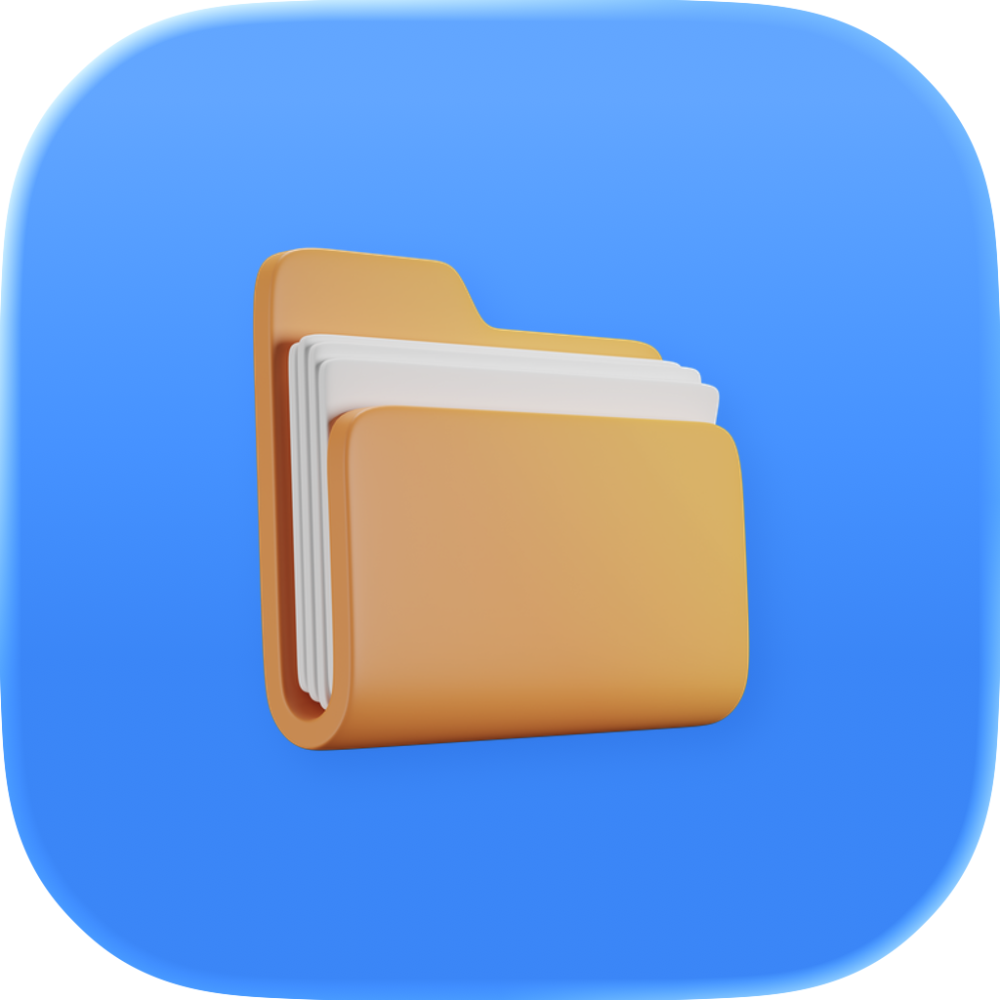

<p align="center">
  
</p>

<h1 align="center">macSSH</h1>

<p align="center">
  <strong>Нативный менеджер SSH / FTP / SMB, монтирования в Finder, терминала и динамического SOCKS5-прокси для macOS</strong>
</p>

<p align="center">
  <em>Чистый Swift и SwiftUI • Универсальный бинарный файл (Apple Silicon и Intel)</em>
</p>

<p align="center">
  
  
  
  <a href="../LICENSE"></a>
</p>

---

<p align="center">
  🌐 <strong>Languages / 多语言 / Ngôn ngữ / Языки / Langues</strong>
</p>

<p align="center">
  <a href="../README.md">English</a> •
  <a href="README_VI.md">Tiếng Việt</a> •
  <a href="README_ZH_CN.md">简体中文</a> •
  <a href="README_ZH_TW.md">繁體中文</a> •
  <strong>Русский</strong> •
  <a href="README_FR.md">Français</a>
</p>

---

## ⚠️ Важно: Только для macOS (macOS Only)

> [!IMPORTANT]
> **macSSH разработан исключительно для платформы Apple macOS.**
> Это 100% нативное приложение на **SwiftUI**, **AppKit**, **SwiftData**, **Network.framework**, **AVKit**, **PDFKit**, **NetFS** и фреймворке безопасности **LocalAuthentication (Touch ID)**.
>
> Приложение **НЕ** поддерживает Windows или Linux, обеспечивая максимальное быстродействие, нулевую задержку ввода и минимальное потребление памяти.

---

## 🌟 Обзор проекта

**macSSH** предлагает полноценное нативное решение для разработчиков, DevOps-инженеров и системных администраторов на Mac:

- **Поддержка нескольких протоколов (`SSH`, `FTP`, `SMB`)**: Управляйте серверами **SSH/SFTP**, **FTP/FTPS** и **SMB/CIFS** в одном окне с автоматическими портами, тематическими иконками/цветами, анонимным/гостевым входом и поиском SMB-шар.
- **Чтение и запись в macOS Finder (FTP и SFTP)**: Монтируйте удалённые FTP/FTPS и SFTP серверы как полноценные диски в **Finder** через встроенный loopback-сервер WebDAV Class 2 (`SwiftNIO`) — **без macFUSE, FUSE-T и `sudo`**.
- **Двухпанельный браузер и многопоточный FTP**: Двусторонний Drag & Drop (Local ⇄ Remote ⇄ Finder), рекурсивная передача папок и настраиваемые **многопоточные FTP-передачи (по умолчанию 10, до 32 потоков)** с параллельной загрузкой по байт-диапазонам.
- **Встроенный универсальный просмотрщик файлов**: Просмотр текста/кода, изображений, PDF, аудио/видео (`AVKit`) и двоичного Hex/ASCII кода прямо в приложении для SSH, FTP и SMB.
- **Быстрые переключатели (`Автоподключение` и `Автомонтирование` FTP)**: Кнопки в правом нижнем углу строки без перезагрузки страницы, автоматический запуск при открытии macSSH / конфига и автомонтирование FTP при нажатии «Подключиться».
- **Нативный OpenSSH терминал и SOCKS5-прокси**: Эмулятор `xterm-256color` (60 FPS), запуск в `Terminal.app` в 1 клик, туннели `/usr/bin/ssh -D` (`127.0.0.1` или LAN `0.0.0.0`) с защитой от процессов-сирот.
- **Мониторинг сети, автопереподключение и Menu Bar**: Проверка сети через `NWPathMonitor`, ступенчатый реконнект и автоматическое скрытие иконки из Dock при работе в строке меню.

---

## ✨ Основные возможности и функции

### 🔌 1. Мультипротокольный менеджер (`SSH` / `FTP` / `SMB`)
- **Переключатель `SSH | FTP | SMB`**: Автоматически подставляет стандартный порт (`22` / `21` / `445`), иконку и цвет протокола.
- **Движок FTP / FTPS**: Работает через системный `/usr/bin/curl` с безопасной передачей пароля через `stdin`, поддерживает списки Unix и Windows/IIS и вход `anonymous`.
- **Движок SMB / CIFS**: Использует `NetFS.framework` и `smbutil`, автоматически обнаруживает общие папки на сервере и аккуратно размонтирует при отключении.

### 💽 2. Монтирование FTP и SFTP в Finder (Read-Write без драйверов)
- **Полноценный диск в Finder**: Локальный **SwiftNIO WebDAV Class 2** и `/sbin/mount_webdav -S -o browse` без kext-расширений и прав администратора.
- **Чистое имя в боковой панели Finder**: Локальная loopback-регистрация через `dnssd` (`lo0` → `127.0.0.1`) отображает **имя** подключения напрямую, без `127.0.0.1` и суффикса `.local`.
- **Потоковая передача без лишних скачиваний**: Кэширование каталогов (`15s`), виртуальные маркеры против сканирования QuickLook/Spotlight/FSEvents (`.ql_disablethumbnails`, `.metadata_never_index`, `.fseventsd/no_log`), теневое хранилище для метаданных macOS (`._*`, `.DS_Store`, `.TemporaryItems`) и чтение `Range`-фрагментами только по требованию.
- **Трёхуровневое автоотмонтирование**: При отключении, извлечении в Finder (`⏏`), выходе (`⌘Q`), сбое (`-S` + `atexit`) и очистке при следующем запуске.

### ⚡ 3. Быстрые настройки (`Автоподключение` и `Автомонтирование` FTP)
- **Переключатели в правом нижнем углу карточки**:
  - **`Автоподключение`** (для всех протоколов): Автоматически подключается при запуске macSSH или открытии файла конфигурации.
  - **`Автомонтирование`** (**только для FTP**): Тихо монтирует том в Finder при запуске и автоматически монтирует диск каждый раз при ручном нажатии **Подключиться (Connect)**.
- **Обновление без перезагрузки страницы**: Состояние переключателей обновляется мгновенно на месте без мерцания и сброса списка (с ожиданием разблокировки Touch ID при старте).

### 🌐 4. Нативный OpenSSH SOCKS5-прокси и контроль процессов
- **Туннель `/usr/bin/ssh -D` в фоне**: Запуск через `forkpty` с защитой от режима сна и конфликтов портов; `NativeProcessRegistry` очищает дочерние процессы через `atexit`, обработчики сигналов и проверку при запуске.

### 📂 5. Двухпанельный менеджер, многопоточный FTP и просмотрщик файлов
- **Двусторонний Drag & Drop и многопоточный FTP (`1–32` потока, по умолчанию `10`)**: Настройка потоков в Настройках, карточке сервера или прямо на панели очереди; рекурсивная передача папок, пакетное подтверждение перезаписи и многосегментное скачивание (`--range` от `4 MB`).
- **Универсальный просмотрщик (SSH, FTP, SMB)**: 5 режимов — Текст/Код (поиск, номера строк, переход в редактор), Изображения (масштабирование), PDF (`PDFKit`), Аудио/Видео (`AVKit`) и Hex/ASCII + **Edit With** с автовыгрузкой при сохранении (`⌘S`).

### 📊 6. Фильтры очереди, Повтор ошибок, Журнал и Интерфейс macOS
- **Счётчики и повтор ошибок**: Кликабельные бейджи «Успешно» / «Ошибка», фильтры по статусу и имени файла, кнопки **Повторить** и **Повторить ошибки** для обеих очередей, плюс **Консоль логов (`⌘⇧L`)** на 200 записей с перетаскиваемой границей (`↕︎`).
- **Мониторинг сети (`NWPathMonitor`)**: Мигающий красный индикатор, уведомление macOS (автоскрытие через 5с) и ступенчатый реконнект (`0s → 5s → 10s`) с обновлением монтирования Finder.
- **Удобство macOS**: Переключение **Тёмная ↔ Светлая тема** в 1 клик на панели инструментов, контекстное меню на пустом месте, полное верхнее меню (`Файл`, `Подключение`, `Вид`), автоскрытие из Dock при закрытии окон, **Touch ID**, шифрование **AES-256-GCM** и **6 языков**.

---

## 📸 Скриншоты (Screenshots)

| Менеджер подключений | Контекстное меню и действия |
|:---:|:---:|
|  |  |
| *Двухколоночный интерфейс, папки, быстрые переключатели* | *Контекстное меню: Finder, SOCKS5 прокси, терминал, SFTP* |

| Двухпанельный браузер и очередь передачи | Встроенный SSH Терминал |
|:---:|:---:|
|  |  |
| *Двусторонний Drag & Drop, прямой ввод пути, скорость и ETA* | *Терминал xterm-256color без задержек* |

---

## 💽 Установка и настройка (Installation & Setup)

### Системные требования
- **macOS**: 15.0+ (Sequoia | Tahoe).
- **Архитектура**: Universal 2 (Полная поддержка **Apple Silicon M1/M2/M3/M4** и **Intel x86_64**).

### 1. Скачивание DMG
Скачайте последнюю версию `macSSH_Universal_x.x.x.dmg` со страницы [GitHub Releases](https://github.com/devduong/macSSH/releases).

### 2. Установка приложения
Откройте файл `.dmg` и перетащите **macSSH.app** в папку **Applications (Программы)** (`/Applications`).

### 3. Первый запуск и обход macOS Gatekeeper

> [!WARNING]
> **Предупреждение (Warning)**  
> Поскольку macSSH — это бесплатный проект с открытым исходным кодом без платного сертификата Apple Developer, macOS Gatekeeper может показать предупреждение: *«Не удается открыть macSSH, так как не удалось подтвердить разработчика»* или *«macOS не может проверить отсутствие вредоносного ПО»*.

Как открыть приложение:
1. Откройте **Системные настройки (System Settings)** на Mac.
2. Перейдите в раздел **Конфиденциальность и безопасность (Privacy & Security)**.
3. Прокрутите вниз до раздела **Безопасность (Security)**.
4. Нажмите кнопку **«Подтвердить вход (Open Anyway)»** рядом с уведомлением о блокировке macSSH.
5. В диалоговом окне подтверждения нажмите **«Открыть (Open)»** и введите пароль Mac или используйте Touch ID.

*(Альтернативный способ: щелкните правой кнопкой мыши / Control-клик по `macSSH.app` в Finder -> выберите **Открыть (Open)** -> нажмите **Открыть**).*

---

### Сборка из исходного кода

#### Требования
- **Xcode**: 16.0 или новее.
- **macOS SDK**: 15.0 или новее.
- **Swift**: 5.9+.

#### Шаги сборки

1. **Клонируйте репозиторий**:
   ```bash
   git clone https://github.com/devduong/macSSH.git
   cd macSSH
   ```

2. **Откройте проект в Xcode**:
   ```bash
   open macSSH.xcodeproj
   ```

3. **Соберите приложение**:
   ```bash
   xcodebuild -project macSSH.xcodeproj -scheme macSSH -configuration Release build
   ```
   *Или выберите схему `macSSH` в Xcode и нажмите `Cmd + B`.*

4. **Запустите собранное приложение**:
   ```bash
   open $(xcodebuild -project macSSH.xcodeproj -scheme macSSH -configuration Release -showBuildSettings | grep -m 1 "BUILT_PRODUCTS_DIR" | awk '{print $3}')/macSSH.app
   ```
   *Или нажмите `Cmd + R` для запуска в Xcode.*

---

## ☕ Поддержка проекта (Donate)

**macSSH** — бесплатный проект с открытым исходным кодом. Если приложение полезно для вашей работы, вы можете поддержать автора чашкой кофе! ❤️

### 1. Поддержка через Ko-fi и GitHub
- ☕ **Поддержать на Ko-fi**: [https://ko-fi.com/X4P324ZPZ3](https://ko-fi.com/X4P324ZPZ3)
- ⭐ **Поставить звезду на GitHub**: [devduong/macSSH](https://github.com/devduong/macSSH)

### 2. Пожертвования в криптовалюте (Crypto Donation)
Вы можете отправить любые токены сети **BNB Smart Chain (BEP20)** (*USDT, BNB, BUSD, USDC и др.*) на указанный адрес кошелька:

- **Сеть (Network)**: `BEP20 (BSC – Binance Smart Chain)`
- **Адрес кошелька (Wallet Address)**:
  ```text
  0xe26c0DC422EF744816Ca3B2d210e6214fdC4e18E
  ```

---

## 🙏 Благодарности и источники (Acknowledgments)

- 🌟 **Особая благодарность [macnev2013](https://github.com/macnev2013)** — автору проектов `macSCP` и `anySCP`. Большое спасибо за отличные первоначальные идеи и фундамент, которые вдохновили на создание и развитие **macSSH**.
- 🚀 [Citadel](https://github.com/Orlandos-nl/Citadel) (Joannis Orlandos) и [SwiftNIO](https://github.com/apple/swift-nio) / [SwiftNIO SSH](https://github.com/apple/swift-nio-ssh) (Apple) — базовые библиотеки протоколов SSH, SFTP и WebDAV.
- 💻 [SwiftTerm](https://github.com/migueldeicaza/SwiftTerm) (Miguel de Icaza) — движок эмуляции терминала для macOS.
- 🎨 [SF Symbols](https://developer.apple.com/sf-symbols/) (Apple) — системные иконки macOS.

---

## 📄 Лицензия (License)

Проект распространяется под свободной лицензией **MIT License** — подробности в файле [LICENSE](../LICENSE).

---

<p align="center">
  Создано с ❤️ для сообщества пользователей macOS.
</p>
