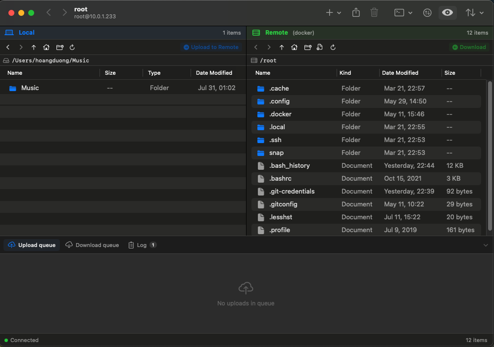

# 🚀 macSSH (macOS Native SSH, FTP, SMB, Finder Mount & SOCKS5 Client)

<p align="center">
  
</p>

<p align="center">
  <strong>Ứng dụng Native macOS đa giao thức cho SSH/SFTP, FTP/FTPS, SMB, Mount Finder Đọc-Ghi & Dynamic SOCKS5 Proxy</strong><br>
  <em>Tương thích hoàn hảo macOS 15.0+ Sequoia | Tahoe (Universal 2: Apple Silicon & Intel)</em>
</p>

<p align="center">
  
  
  
  
  <a href="https://github.com/devduong/macSSH/releases"></a>
  <a href="https://ko-fi.com/X4P324ZPZ3"></a>
</p>

---

## 🌍 Ngôn Ngữ / Languages

[English](../README.md) | [Tiếng Việt](README_VI.md) | [简体中文](README_ZH_CN.md) | [繁體中文](README_ZH_TW.md) | [Русский](README_RU.md) | [Français](README_FR.md)

---

## 🌟 Giới Thiệu Tổng Quan

**macSSH** là ứng dụng native dành riêng cho macOS, được xây dựng hoàn toàn bằng **SwiftUI**, **AppKit**, **SwiftData**, **Network.framework**, **AVKit**, **PDFKit** và **NetFS**:

- 🔌 **Hỗ Trợ Đa Giao Thức (`SSH`, `FTP`, `SMB`)**: Quản lý đồng nhất máy chủ **SSH/SFTP**, **FTP/FTPS** và **SMB/CIFS** với cổng mặc định, icon/màu sắc nhận diện riêng, đăng nhập ẩn danh/khách và tự khám phá SMB Share.
- 💽 **Mount FTP & SFTP Trực Tiếp Vào Finder (Đọc & Ghi)**: Biến máy chủ FTP/SFTP thành ổ đĩa trực tiếp trong **Finder** thông qua cầu nối WebDAV Class 2 cục bộ tích hợp sẵn — **không cần macFUSE, FUSE-T hay `sudo`**.
- ⚡ **Truyền Tải FTP Đa Luồng Tốc Độ Cao (Mặc Định 10 Luồng)**: Kéo thả hai chiều (Local ⇄ Remote ⇄ Finder), upload/download thư mục đệ quy, tải phân đoạn đa luồng (`--range`) và tùy chỉnh `1–32` luồng theo phiên hoặc từng kết nối.
- 👁️ **Trình Xem Tệp Đa Năng Tích Hợp (SSH, FTP, SMB)**: Xem nhanh văn bản/mã nguồn, hình ảnh, PDF, phát audio/video (`AVKit`) và xem mã Hex/ASCII ngay trong app.
- 🤖 **Cài Đặt Nhanh `Auto Connect` & `Auto Mount` (FTP)**: Nút bật/tắt tức thì ngay góc dưới bên phải từng item (không reload trang), tự chạy khi mở app / mở cấu hình và tự mount khi bấm **Connect** đối với FTP.
- 🌐 **Native OpenSSH Terminal & SOCKS5 Proxy**: Giả lập `xterm-256color` 60 FPS, mở Terminal.app 1 click, tunnel `/usr/bin/ssh -D` ổn định qua Sleep/Wake và quản lý tiến trình con chống orphan.
- 📡 **Giám Sát Internet Real-Time & Auto-Reconnect**: Nhận diện mất mạng tức thì (`NWPathMonitor`), thông báo native tự ẩn sau 5s, tự động kết nối lại theo chu kỳ `0s → 5s → 10s` và ẩn icon Dock gọn gàng khi chạy nền trên Menu Bar.

---

## ✨ Tính Năng Nổi Bật

### 🔌 1. Quản Lý Đa Giao Thức: `SSH` / `FTP` / `SMB`
- **Chọn Nhanh Giao Thức (`SSH | FTP | SMB`)**: Tự động điền cổng chuẩn (`22` / `21` / `445`), đổi icon/màu đặc trưng theo giao thức và ẩn các tùy chọn không liên quan.
- **Engine FTP / FTPS**: Dùng `/usr/bin/curl` truyền thông tin đăng nhập an toàn qua stdin (`--config -`, không lộ qua `ps aux`), đọc chuẩn cả định dạng Unix và Windows/IIS FTP, hỗ trợ tài khoản `anonymous`.
- **Engine SMB / CIFS**: Tích hợp `NetFS.framework` và `/usr/bin/smbutil`, tự liệt kê danh sách Share tại `/` hoặc mount thẳng `host/ShareName`, hỗ trợ tài khoản `guest` và tự gỡ mount khi ngắt kết nối.

### 💽 2. Mount Máy Chủ FTP & SFTP Vào Finder Đọc-Ghi (Không Cần Driver Ngoài)
- **Thao Tác Như Thư Mục Mac Thật**: Sử dụng **SwiftNIO WebDAV Class 2 Loopback** kết hợp `/sbin/mount_webdav -S -o browse` — không cần cài kernel extension hay quyền `sudo`.
- **Hiển Thị Đúng Tên Kết Nối Trên Finder**: Đăng ký hostname loopback cục bộ (`lo0` → `127.0.0.1` qua `dnssd`) để Sidebar Finder hiển thị trực tiếp **`Name`** của kết nối thay vì `127.0.0.1` hay `.local`.
- **Streaming Thông Minh — Không Tải Thừa Khi Mở Thư Mục**: Duyệt thư mục chỉ gọi metadata (`PROPFIND` cache `15s`), tích hợp tệp sentinel chặn QuickLook/Spotlight/FSEvents tự quét (`.ql_disablethumbnails`, `.metadata_never_index`, `.fseventsd/no_log`) cùng kho lưu đệm tệp rác Apple (`._*`, `.DS_Store`, `.TemporaryItems`). Tệp chỉ tải theo phân đoạn `Range` khi mở thực tế và hủy luồng ngay lập tức nếu đóng socket.
- **Tự Hủy An Toàn 3 Tầng**: Tự gỡ mount khi ngắt kết nối, bấm Eject trong Finder (`⏏`), thoát app (`⌘Q`), sự cố crash (`-S` + `atexit`), và dọn sạch mount cũ khi khởi động lại.

### ⚡ 3. Cài Đặt Nhanh (`Auto Connect` & `Auto Mount` FTP) — Không Reload Trang
- **Nút Bật/Tắt Trực Tiếp Dưới Góc Phải Từng Kết Nối**:
  - **`Auto Connect`** (mọi kết nối): Tự động kết nối phiên làm việc khi mở macSSH hoặc mở file cấu hình (chờ mở khóa Touch ID nếu bật App Lock).
  - **`Auto Mount`** (**chỉ dành cho FTP**): Tự động mount thầm vào Finder khi mở app **và** tự động mount ngay mỗi khi bạn bấm **Connect** (qua menu chuột phải, Menu Bar, phím Return hoặc mở File Browser).
- **Cập Nhật Tức Thì Không Nháy / Reload**: Bật/tắt `Auto Connect`, `Auto Mount`, `Saved` hoặc `SOCKS5` cập nhật trực tiếp tại chỗ mà không nạp lại danh sách hay mất vị trí cuộn.

### 🌐 4. Native OpenSSH SOCKS5 Proxy & Chống Tiến Trình Mồ Côi
- **Native OpenSSH Tunnel (`/usr/bin/ssh -D`)**: Khởi chạy headless qua `forkpty`, truyền mật khẩu qua kernel FD, ổn định tuyệt đối qua Sleep/Wake và App Nap.
- **Localhost & Chia Sẻ LAN**: Hỗ trợ `127.0.0.1` hoặc `0.0.0.0` (tự hiển thị IP LAN), bật/tắt trực tiếp trên hàng kết nối và tự tắt an toàn + báo Toast 5s nếu trùng port.
- **`NativeProcessRegistry`**: Theo dõi toàn bộ tiến trình con, tự dọn qua `atexit`, C signal handlers và quét tiến trình mồ côi khi khởi động.

### 📂 5. File Browser Dual-Pane & Truyền Tải FTP Đa Luồng (Mặc Định 10 Luồng)
- **Kéo Thả 2 Chiều & Ra Finder**: Kéo thả Local ⇄ Remote hoặc kéo thẳng tệp remote ra **Finder** (`NSFilePromiseProvider`), tải đệ quy thư mục con, nhập đường dẫn trực tiếp (`⌘L` / `⇧⌘G`), chọn ghi đè hàng loạt (`Replace`, `Replace All`, `Skip`, `Cancel`).
- **Tùy Chỉnh Luồng FTP (`1–32` Luồng, Mặc Định `10`)**:
  - Chỉnh trong **Settings**, riêng từng server FTP, hoặc ngay trên thanh hàng đợi (**`10 streams`** với preset `1 / 5 / 10 / 20 / 32`).
  - Hỗ trợ tải 1 file lớn song song nhiều phân đoạn byte (`curl --range` cho file >= 4 MB), hiển thị tốc độ/ETA realtime cho cả upload & download, quét file off-main-thread và gom nhóm `*MKD` không gây khựng UI.

### 👁️ 6. Trình Xem Tệp Đa Năng & "Edit With" Tự Upload Khi Lưu
- **Universal File Viewer (SSH, FTP, SMB)**: Bấm icon mắt (`eye.fill`), menu chuột phải hoặc double-click để xem 5 định dạng:
  - **Text / Code / Log**: Đánh số dòng, tìm kiếm, Copy, chuyển nhanh sang Editor.
  - **Image**: Zoom `-` / `100%` / `+` / `Reset` kèm độ phân giải gốc.
  - **PDF**: Cuộn trang & phóng to mượt mà trên `PDFKit`.
  - **Audio / Video**: Phát trực tiếp `.mp4`, `.mov`, `.mp3`, `.wav`, `.m4a` bằng `AVKit` + nút `Open Externally`.
  - **Binary Hex & ASCII**: Soi 4 KB đầu dạng 16-byte + `Open Externally`.
- **"Edit With" Tự Đồng Bộ Khi Bấm `⌘S`**: Mở tệp bằng VS Code, Xcode, Sublime Text,... tự phát hiện lưu và upload ghi đè lên server (theo dõi trong Upload Queue).

### 📊 7. Bảng Hàng Đợi Chi Tiết, Retry Lỗi & Khung Activity Logs
- **Bộ Đếm, Lọc Trạng Thái & Thử Lại (Retry)**: Hai nút thống kê **`✓ Thành công`** / **`✕ Thất bại`** (bấm để lọc nhanh), chip lọc (`Tất cả`, `Đang chạy`, `Thành công`, `Thất bại`, `Đã hủy`), ô lọc tên tệp và nút **Thử lại** từng tệp hoặc **Thử lại lỗi** hàng loạt.
- **Activity Log Console Trực Tiếp (`⌘⇧L`)**: Ghi nhận sự kiện hệ thống (tối đa 200 log mới nhất, 0 chi phí cấp phát chuỗi ở bản Release), lọc theo cấp độ/danh mục và kéo chỉnh chiều cao bằng con trỏ `↕︎`.

### 📡 8. Giám Sát Mạng Real-Time & Trải Nghiệm Native macOS
- **`NWPathMonitor` & Progressive Auto-Reconnect**: Báo **Mất kết nối** đỏ nhấp nháy ngay khi đứt mạng kèm macOS notification tự ẩn sau 5s; khi có mạng lại tự dọn session cũ và kết nối lại (`0s → 5s → 10s`), đồng thời làm mới session của các ổ đĩa Finder đang mount.
- **Giao Diện Sáng / Tối 1 Click & Menu Đầy Đủ**: Nút icon đổi nhanh **Sáng ↔ Tối** góc phải Toolbar (`System` / `Light` / `Dark`), Context Menu khi chuột phải **vùng trống** Sidebar (`New Folder`) & danh sách (`New Connection`), đồng bộ đầy đủ **macOS Top Menu Bar** (`File`, `Connection`, `View`), ẩn icon Dock khi thu gọn xuống Menu Bar, khóa **Touch ID**, mã hóa mật khẩu **AES-256-GCM** vào file JSON và hỗ trợ **6 ngôn ngữ** (EN, VI, ZH-Hans, ZH-Hant, RU, FR).

---

## 📸 Hình Ảnh Ứng Dụng (Screenshots)

| Quản Lý Kết Nối & Thư Mục | Menu Chuột Phải & Thao Tác Nhanh |
|:---:|:---:|
|  |  |
| *Giao diện 2 cột tinh gọn, phân nhóm thư mục, cài đặt nhanh* | *Menu chuột phải: Mount Finder, SOCKS5 proxy, Terminal, SFTP* |

| Trình Duyệt Tệp Song Song & Hàng Đợi | Giả Lập SSH Terminal Tích Hợp |
|:---:|:---:|
|  |  |
| *Kéo thả hai chiều, thanh nhập đường dẫn, tốc độ truyền tải & ETA realtime* | *Terminal xterm-256color không độ trễ, giao diện native mượt mà* |

---

## 💽 Hướng Dẫn Cài Đặt & Thiết Lập (Installation & Setup)

### Yêu Cầu Hệ Thống
- **macOS**: 15.0+ (Sequoia | Tahoe).
- **Kiến Trúc**: Universal 2 (Hỗ trợ tối ưu cả **Apple Silicon M1/M2/M3/M4** và **Intel x86_64**).

### Lựa Chọn 1: Tải Bản Cài Đặt DMG (Khuyên dùng)
1. Tải phiên bản mới nhất `macSSH_Universal_x.x.x.dmg` từ mục [GitHub Releases](https://github.com/devduong/macSSH/releases).
2. Mở tệp `.dmg` đã tải về và kéo biểu tượng **macSSH.app** vào thư mục **Applications** (`/Applications`).

> [!IMPORTANT]
> **Mở Ứng Dụng Lần Đầu (Vượt macOS Gatekeeper):**
> Nếu macOS hiển thị thông báo *"macSSH cannot be opened because Apple cannot check it for malicious software"*:
> 1. Mở **System Settings** (Cài đặt hệ thống) trên máy Mac của bạn.
> 2. Chọn mục **Privacy & Security** (Quyền riêng tư & Bảo mật).
> 3. Cuộn xuống phần **Security** (Bảo mật).
> 4. Nhấn vào nút **"Open Anyway"** (Mở dù sao đi nữa) bên cạnh thông báo macSSH bị chặn.
> 5. Trong hộp thoại xác nhận, nhấn **"Open"** (Mở) và nhập mật khẩu máy Mac hoặc dùng Touch ID.

---

### Lựa Chọn 2: Biên Dịch Từ Mã Nguồn (Build from Source)

#### Yêu Cầu Phát Triển
- **Xcode**: 16.0 trở lên.
- **macOS SDK**: 15.0 trở lên.
- **Swift**: 5.9+.

#### Các Bước Thực Hiện

1. **Clone repository**:
   ```bash
   git clone https://github.com/devduong/macSSH.git
   cd macSSH
   ```

2. **Mở dự án trong Xcode**:
   ```bash
   open macSSH.xcodeproj
   ```

3. **Biên dịch ứng dụng**:
   ```bash
   xcodebuild -project macSSH.xcodeproj -scheme macSSH -configuration Release build
   ```
   *Hoặc chọn scheme `macSSH` trong Xcode và nhấn `Cmd + B`.*

4. **Khởi chạy ứng dụng**:
   ```bash
   open $(xcodebuild -project macSSH.xcodeproj -scheme macSSH -configuration Release -showBuildSettings | grep -m 1 "BUILT_PRODUCTS_DIR" | awk '{print $3}')/macSSH.app
   ```
   *Hoặc nhấn `Cmd + R` để chạy trực tiếp trong Xcode.*

---

## ☕ Ủng Hộ Dự Án (Donate)

**macSSH** là dự án mã nguồn mở phi lợi nhuận được phát triển với mục tiêu mang lại công cụ làm việc tốt nhất cho cộng đồng macOS. Nếu bạn thấy macSSH hữu ích cho công việc hàng ngày, hãy ủng hộ tác giả một tách cà phê để tiếp tục duy trì và phát triển dự án nhé! ❤️

### 1. Hỗ Trợ Qua Ko-fi & GitHub
- ☕ **Ko-fi**: [https://ko-fi.com/X4P324ZPZ3](https://ko-fi.com/X4P324ZPZ3)
- 🌟 **GitHub Star**: Tặng một ngôi sao tại [https://github.com/devduong/macSSH](https://github.com/devduong/macSSH)

### 2. Ủng Hộ Qua Tiền Mã Hóa (Crypto Donation - BEP20)
- **Network**: `BEP20 (Binance Smart Chain - BSC)`
- **Địa Chỉ Ví**: `0xe26c0DC422EF744816Ca3B2d210e6214fdC4e18E`
- *(Chấp nhận mọi token trên mạng BEP20 như USDT, BNB, BUSD, ETH...)*

---

## 📜 Giấy Phép & Bản Quyền (License)

Dự án được phân phối dưới giấy phép **MIT License** — xem tệp [LICENSE](../LICENSE) để biết thêm chi tiết.

Cảm ơn đặc biệt tới **macnev2013** (tác giả dự án gốc `macSCP`) đã tạo tiền đề cảm hứng cho sự phát triển của macSSH!
