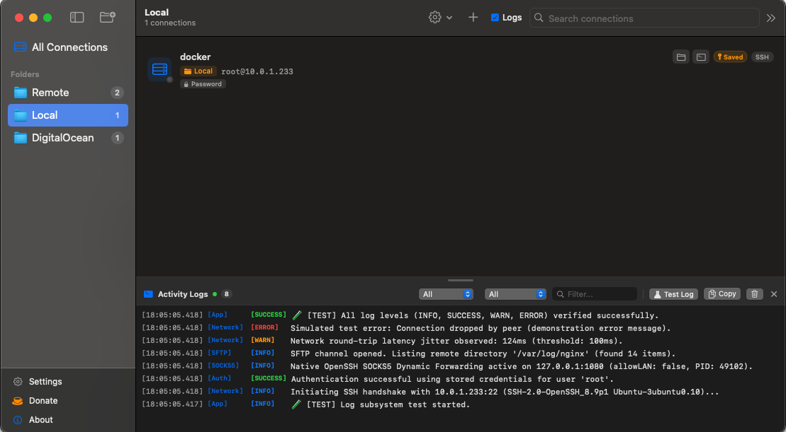
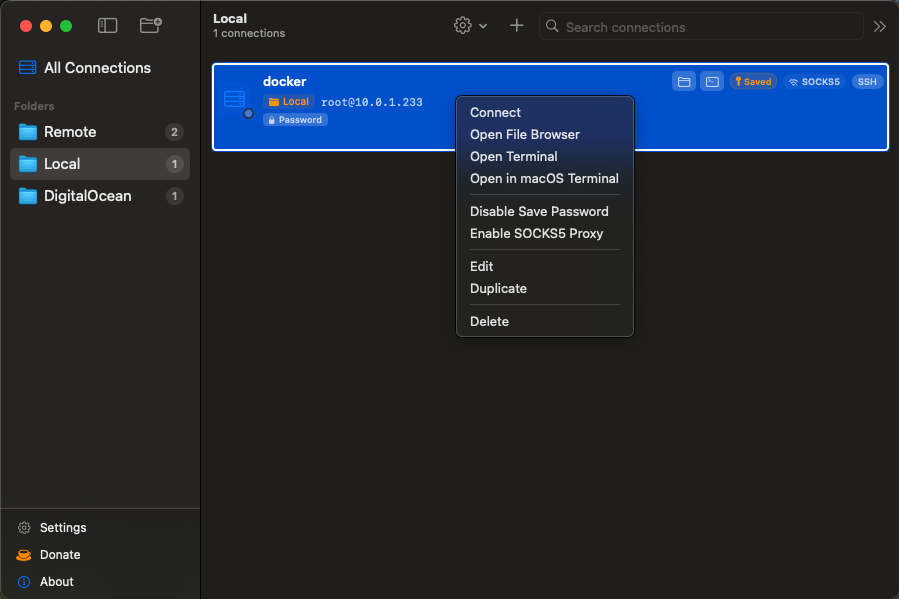

<p align="center">
  
</p>

<h1 align="center">macSSH</h1>

<p align="center">
  <strong>專為 macOS 打造的原生 SSH 連線管理、雙欄 SFTP 瀏覽器、終端機模擬器與動態 SOCKS5 代理工具</strong>
</p>

<p align="center">
  <em>純 Swift & SwiftUI 開發 • 通用二進位架構 (Apple 晶片 & Intel)</em>
</p>

<p align="center">
  
  
  
  <a href="../LICENSE"></a>
</p>

---

<p align="center">
  🌐 <strong>Languages / 多语言 / Ngôn ngữ / Языки / Langues</strong>
</p>

<p align="center">
  <a href="../README.md">English</a> •
  <a href="README_VI.md">Tiếng Việt</a> •
  <a href="README_ZH_CN.md">简体中文</a> •
  <strong>繁體中文</strong> •
  <a href="README_RU.md">Русский</a> •
  <a href="README_FR.md">Français</a>
</p>

---

## ⚠️ 重要說明：僅支援 macOS (macOS Only)

> [!IMPORTANT]
> **macSSH 是專門為 Apple macOS 平台量身打造的原生應用程式。**
> 100% 採用 **SwiftUI**、**AppKit**、**SwiftData** 以及 Apple 原生 **LocalAuthentication (Touch ID)** 與安全框架開發。
> 
> 本應用程式**不支援** Windows 或 Linux 系統，具有極致的原生反應速度、零按鍵延遲以及極低的記憶體佔用。

---

## 🌟 專案概述

**macSSH** 為在 Mac 上管理遠端伺服器的開發者、DevOps 與系統管理員提供了一站式原生解決方案：

- **雙欄 SFTP 檔案管理員 (Dual-Pane)**：支援本機與遠端檔案面板之間的雙向拖放傳輸，並可直接拖放至 macOS Finder。
- **高效能 SSH 終端機**：基於 SwiftTerm 實現的 60 FPS `xterm-256color` 終端機模擬器，採用 OpenSSH 標準 PTY 直傳模式（按鍵零延遲），並支援一鍵直接在 macOS 原生 `Terminal.app` 中啟動。
- **動態 SOCKS5 代理 (SSH Tunnel)**：自動透過 SSH 通道開啟內建 SOCKS5 代理服務，支援本機回呼 (`127.0.0.1`) 或區域網路全網段共享 (`0.0.0.0`)，支援一鍵切換與連接埠衝突自動處理。
- **「開啟方式」與儲存自動同步 (Open With & Auto-Sync)**：可在 Mac 上的任何文字編輯器（VS Code、Xcode、TextEdit 等）中開啟遠端檔案，按下儲存 (`⌘S`) 時自動上傳覆蓋至遠端伺服器。
- **選單列常駐與背景執行**：常駐 macOS 頂部選單列，關閉全部視窗後仍可保持 SSH 連線與代理通道。
- **獨立安全的設定檔管理**：支援 JSON 設定檔匯入匯出、自動記憶並載入上次使用的設定檔、Touch ID 生物辨識應用程式鎖定以及 AES-256-GCM 密碼硬體加密。

---

## ✨ 核心功能與特色

### 🌐 1. 動態 SOCKS5 代理 (SSH Tunnel)
- **一鍵代理通道**：連線 SSH 時自動開啟 SOCKS5 代理服務，安全轉發網路流量。
- **本機與區域網路共享**：可選擇監聽 `127.0.0.1`（僅本機）或 `0.0.0.0`（共享至區域網路內其他裝置，自動顯示目前 Mac 的區域網路 IP）。
- **快速切換徽章**：伺服器列表行顯示紫色 SOCKS5 徽章，點擊即可快速開啟或關閉代理。
- **智慧連接埠衝突處理**：當連接埠被占用時，macSSH 會自動安全關閉代理並透過 5 秒毛玻璃 Toast 提示，不影響主 SSH 連線。

### 📂 2. 雙欄 SFTP 檔案瀏覽與雙向原生拖放
- **雙欄直觀版面配置**：左側本機檔案面板，右側遠端伺服器檔案面板。
- **雙向拖放支援**：
  - 本機拖向遠端直接上傳。
  - 遠端拖向本機（或特定子目錄）立即下載。
  - 支援透過 `NSFilePromiseProvider` 將遠端檔案直接拖放至 **macOS Finder**。
- **遞迴下載整個目錄**：自動遞迴建立多層子目錄並完整下載。
- **直接路徑輸入列**：支援隨時輸入或貼上絕對路徑（如 `/var/www`），快速鍵 `⌘L` 或 `⇧⌘G`。
- **安全覆蓋確認**：當目標路徑存在同名檔案時，彈出 `NSAlert` 提示選擇「覆蓋 (Replace)」或「取消 (Cancel)」。
- **精簡表格體驗**：消除橫向捲軸，欄寬自適應，支援多選批次刪除。

### 📝 3. 「開啟方式」外部編輯器與儲存自動同步
- **任何 Mac 應用程式開啟**：右鍵選單提供 `Open With Default App` 與 `Open With…`（智慧辨識系統中已安裝的 VS Code、Xcode、Sublime Text、TextEdit 等）。
- **`⌘S` 自動同步**：內建 2 秒輪詢監聽。在外部應用程式中儲存時，自動偵測變更並即時上傳覆蓋至伺服器。

### 💻 4. 完整 SSH 終端機與零延遲輸入
- **流暢終端機模擬**：基於 [SwiftTerm](https://github.com/migueldeicaza/SwiftTerm)，支援 60 FPS 繪製與完整 `xterm-256color`。
- **零延遲直傳模式**：遵循 OpenSSH 標準 PTY 模式，主執行緒位元組流直推，徹底消除按鍵延遲與緩衝卡頓。
- **一鍵呼叫 macOS 原生終端機**：工具列與右鍵選單提供 **「Open in macOS Terminal」**，透過 AppleScript 一鍵啟動系統內建終端機。
- **驗證失敗重新提示**：自動識別密碼錯誤並彈出密碼重試視窗。

### 📊 5. 傳輸佇列管理面板與即時記錄
- **底部 3 標籤頁控制面板**：
  - 📤 **上傳佇列 (Upload Queue)**：顯示進度百分比、已傳輸大小、**即時傳輸速率 (MB/s, KB/s)**、**剩餘預估時間 (ETA)** 與取消控制。
  - 📥 **下載佇列 (Download Queue)**：即時監控檔案下載進度與速率。
  - 📜 **主控台記錄 (Log Console)**：帶有時間戳記 `[HH:mm:ss]` 和顏色分級（`[INFO]`、`[SUCCESS]`、`[WARN]`、`[ERROR]`）的即時 SFTP 操作記錄。
- **純記憶體運作機制**：傳輸佇列與記錄僅在活動工作階段的記憶體中保留，關閉視窗後自動釋放。

### 🗂️ 6. 現代雙欄版面配置與便捷操作
- **雙欄結構**：側邊欄（資料夾、設定、贊助、關於）與連線列表。
- **跨欄拖放分類**：直接將伺服器拖入側邊欄資料夾進行分類管理。
- **按兩下自動連線**：按兩下伺服器項目立即建立連線並開啟檔案瀏覽器。
- **即時連線狀態同步**：連線成功後狀態指示燈立即變為綠色。
- **快捷操作按鈕**：每行均常駐顯示 📁 開啟檔案瀏覽器 與 `>_` 開啟終端機 按鈕。

### 💾 7. 獨立設定檔管理與生物辨識安全
- **JSON 設定檔**：儲存 (`⌘S`)、另存新檔 (`⇧⌘S`)、開啟 (`⌘O`)、新增設定 (`⌘⌥N`)。
- **自動記憶設定檔**：記錄目前使用的設定檔並在啟動時自動重新載入。
- **結束儲存提醒**：在存在未儲存變更時彈出「儲存 / 不儲存 / 取消」提示。
- **AES-256-GCM 密碼加密**：密碼可安全加密並儲存於設定檔內，不強制依賴系統 Keychain。
- **Touch ID 指紋鎖**：支援使用 Touch ID 或 Mac 開機密碼鎖定/解鎖應用程式。

### 🌐 8. 多語言國際化架構 (L10N)
- 支援多種語言並具備英文自動降級（Fallback）機制：
  - 🇬🇧 英語 (**English** - 預設降級)
  - 🇻🇳 越南語 (**Tiếng Việt**)
  - 🇨🇳 簡體中文 (**简体中文**)
  - 🇹🇼 繁體中文 (**繁體中文**)
  - 🇷🇺 俄語 (**Русский**)
  - 🇫🇷 法語 (**Français**)
- 設定中即時切換語言，無需重新啟動應用程式。

---

## 📸 應用截圖 (Screenshots)

| 連線管理與側邊欄 | 右鍵選單與快捷操作 |
|:---:|:---:|
|  |  |
| *雙欄極簡佈局，資料夾分類管理，快速連線* | *右鍵選單：SOCKS5 代理、終端機、SFTP 瀏覽器* |

| 雙欄 SFTP 瀏覽器與傳輸佇列 | 內建 SSH 終端機 |
|:---:|:---:|
|  |  |
| *雙向原生拖曳、路徑直接跳轉、即時傳輸速度與 ETA* | *零延遲 xterm-256color 終端機模擬器* |

---

## 💽 安裝與使用指南 (Installation & Setup)

### 系統需求
- **macOS**：15.0+ (Sequoia | Tahoe)。
- **架構**：Universal 2 (完美支援 **Apple Silicon M1/M2/M3/M4** 與 **Intel x86_64** 晶片)。

### 1. 下載 DMG 安裝檔
從 [GitHub Releases](https://github.com/devduong/macSSH/releases) 下載最新發布的 `macSSH_Universal_x.x.x.dmg`。

### 2. 安裝應用程式
開啟 `.dmg` 映像檔並將 **macSSH.app** 拖入 **Applications (應用程式)** 資料夾 (`/Applications`)。

### 3. 首次啟動與 macOS Gatekeeper 安全提示處理

> [!WARNING]
> **安全警告 (Warning)**  
> 由於 macSSH 是免費的開源專案且未購買昂貴的 Apple 開發者付費憑證簽名，macOS Gatekeeper 安全防護可能會提示：*「無法打開 macSSH，因為無法驗證開發者」* 或 *「macOS 無法驗證此 App 是否包含惡意軟體」*。

打開 App 的步驟：
1. 打開 Mac 上的 **系統設定 (System Settings)**。
2. 進入 **隱私權與安全性 (Privacy & Security)**。
3. 向下捲動至 **安全性 (Security)** 區域。
4. 點擊提示「已阻擋使用 macSSH」旁邊的 **「強制打開 (Open Anyway)」** 按鈕。
5. 在彈出的二次確認對話框中點擊 **「打開 (Open)」** 並輸入 Mac 密碼或使用 Touch ID。

*(替代方案：在 Finder 中按右鍵 / 按住 Control 點擊 `macSSH.app` -> 選擇 **打開 (Open)** -> 再次點擊 **打開** 即可)。*

---

### 從原始碼編譯建置

#### 環境需求
- **Xcode**：16.0 或更高版本。
- **macOS SDK**：15.0 或更高版本。
- **Swift**：5.9+。

#### 建置步驟

1. **複製儲存庫**：
   ```bash
   git clone https://github.com/devduong/macSSH.git
   cd macSSH
   ```

2. **在 Xcode 中開啟專案**：
   ```bash
   open macSSH.xcodeproj
   ```

3. **編譯應用程式**：
   ```bash
   xcodebuild -project macSSH.xcodeproj -scheme macSSH -configuration Release build
   ```
   *或在 Xcode 中選擇 `macSSH` Scheme 並按 `Cmd + B`。*

4. **啟動建置出的應用程式**：
   ```bash
   open $(xcodebuild -project macSSH.xcodeproj -scheme macSSH -configuration Release -showBuildSettings | grep -m 1 "BUILT_PRODUCTS_DIR" | awk '{print $3}')/macSSH.app
   ```
   *或在 Xcode 中按 `Cmd + R` 直接執行。*

---

## ☕ 贊助與支持 (Donate)

**macSSH** 是一款開源且免費的專案，致力於為 macOS 社群帶來高效愉悅的伺服器管理體驗。如果 macSSH 對您的工作有所幫助，歡迎贊助一杯咖啡支持後續的開發與維護！❤️

### 1. 透過 Ko-fi 與 GitHub 支持
- ☕ **Ko-fi 贊助**：[https://ko-fi.com/X4P324ZPZ3](https://ko-fi.com/X4P324ZPZ3)
- ⭐ **在 GitHub 點亮 Star**：[devduong/macSSH](https://github.com/devduong/macSSH)

### 2. 加密貨幣贊助 (Crypto Donation)
您可以透過 **BNB Smart Chain (BEP20)** 發送任何代幣（如 *USDT、BNB、BUSD、USDC 等*）至下方錢包地址：

- **網路 (Network)**：`BEP20 (BSC – Binance Smart Chain)`
- **錢包地址 (Wallet Address)**：
  ```text
  0xe26c0DC422EF744816Ca3B2d210e6214fdC4e18E
  ```

---

## 🙏 致謝與來源 (Acknowledgments)

- 🌟 **特別鳴謝 [macnev2013](https://github.com/macnev2013)** — `macSCP` 與 `anySCP` 的作者。非常感謝他早期出色的設計理念與專案基礎，為 **macSSH** 的構想與演進提供了至關重要的靈感。
- 🚀 [Citadel](https://github.com/Orlandos-nl/Citadel) (Joannis Orlandos) & [SwiftNIO SSH](https://github.com/apple/swift-nio-ssh) (Apple) — 核心 SSH 與 SFTP 協定基礎。
- 💻 [SwiftTerm](https://github.com/migueldeicaza/SwiftTerm) (Miguel de Icaza) — 強大的 macOS 終端機模擬函式庫。
- 🎨 [SF Symbols](https://developer.apple.com/sf-symbols/) (Apple) — 原生 macOS 系統圖示體系。

---

## 📄 授權協議 (License)

本專案基於 **MIT License** 協定開源 — 詳見 [LICENSE](../LICENSE) 檔案。

---

<p align="center">
  專為 macOS 使用者精心打造 ❤️
</p>
